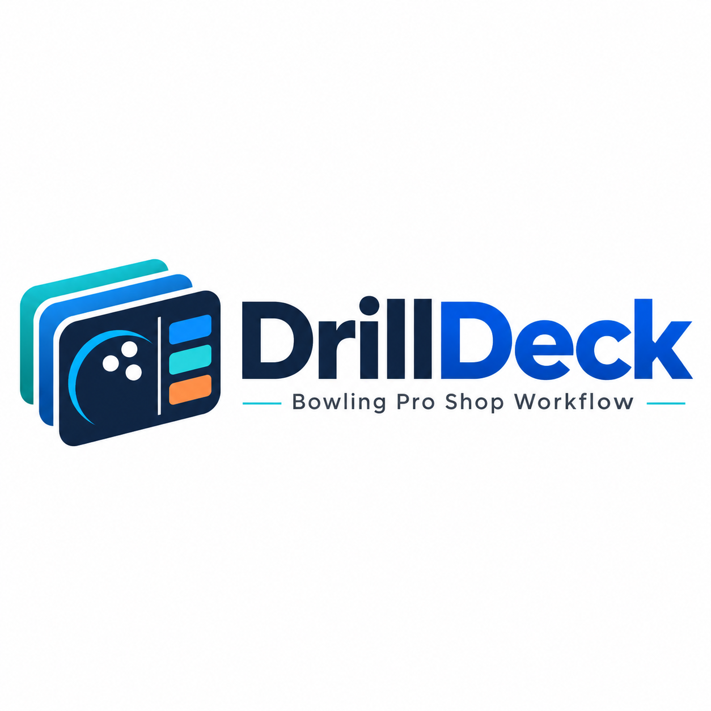

# DrillDeck

<p align="center">
  
</p>

Mobile-first bowling pro shop operations system built with Laravel 13, Fortify, Bootstrap 5, Blade, Sass and SortableJS.

## Install and run locally

Requires PHP 8.3+, Composer 2, Node.js 22+, npm, MySQL 8+.

```bash
git clone https://github.com/caseypc/DrillDeck.git
cd DrillDeck

composer install
npm ci
cp .env.example .env
php artisan key:generate
# Configure DB_* and MAIL_* in .env
php artisan migrate
php artisan db:seed

npm run build
php artisan test
php artisan serve
```

Run `php artisan db:seed` to populate shop-configurable ball catalog defaults. In a local or testing environment, it also creates demonstration customers, staff, orders, ball inventories, fitting sheets, drilling revisions, workflow stages, status history, and an expired invitation. Demo data is never created when `APP_ENV=production`.

**Local demo login**: `demo-owner@example.test` or `demo-staff@example.test`, password `demo-password-123456`. Do not import demo data into a live shop.

Do not commit `.env`, a local database, uploaded files, logs, or generated framework caches. Start from `.env.example`, generate a new application key, and use a separate database for every environment.

## Production checklist

Before exposing a shop to customers or staff:

- Set `APP_ENV=production` and `APP_DEBUG=false`.
- Configure MySQL, encrypted HTTPS sessions, cache/queue workers, and a real mail transport.
- Run migrations and the production-safe seed command against a new database.
- Build assets with `npm ci` and `npm run build`, then configure the web server to serve `public/`.
- Confirm login throttling, password reset mail, invitation links, file upload storage, backups, and authorization with a real shop account.

The application is released as an operational MVP.

## Routes

- /shop: Kanban dashboard.
- /shop/orders: Searchable employee work-order table.
- /shop/customers: Customer directory, ball arsenal, and shared versioned hand fitting.
- /shop/balls: Ball inventory with configurable manufacturer/product dropdowns.
- /shop/balls/{ball}: Drilling workspace, revisions, photo capture and visualizer.
- /shop/catalog: Shop-owned dropdown values (add, rename, deactivate).
- /shop/workflow: Add, rename, drag-reorder and safely delete columns; automation rules.
- /shop/staff: Staff invitations.
- /portal: Customer order requests and tracking.

The original /shop/drilling entry point links to the newer ball-specific workspace. The earlier POST integration remains as a compatibility endpoint.

## Fitting versus drilling

Baseline hand-fitting measurements are **customer-level, versioned, and shared** across multiple bowling balls. Drilling layout revisions are **ball-specific** and can reference a fixed fitting version. Both history chains are append-only through the application.

The visualizer is an **interactive conceptual 3D-styled sphere**, not a calibrated machine diagram or a predictive bowling ball simulation. Ball photographs can be taken on a phone and compared privately against the schematic. Pixel-to-coordinate image projection, oval calculations, track-interference adjustment, and validated drill geometry are not yet implemented.

## Verification

The verification workflow runs PHP feature tests with SQLite and builds Vite assets. MySQL-specific behavior, user acceptance testing on tablets, and professional fitting/drilling approval are still required before production use. See [Verification](docs/VERIFICATION.md) for the repeatable checks and known gaps.